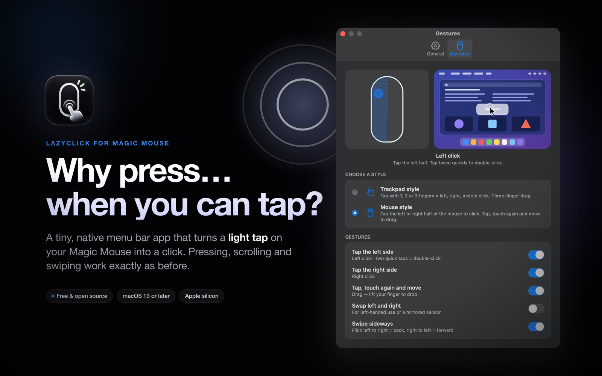
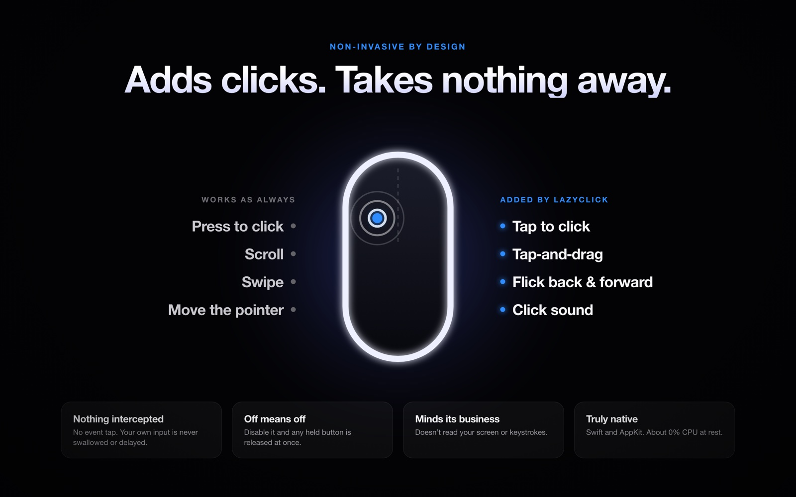
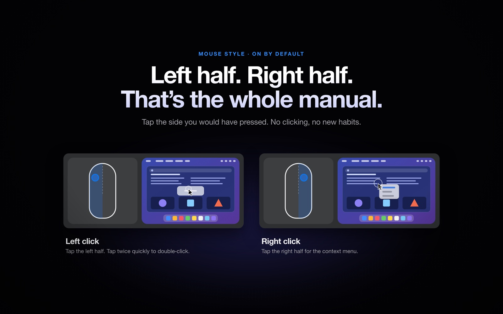
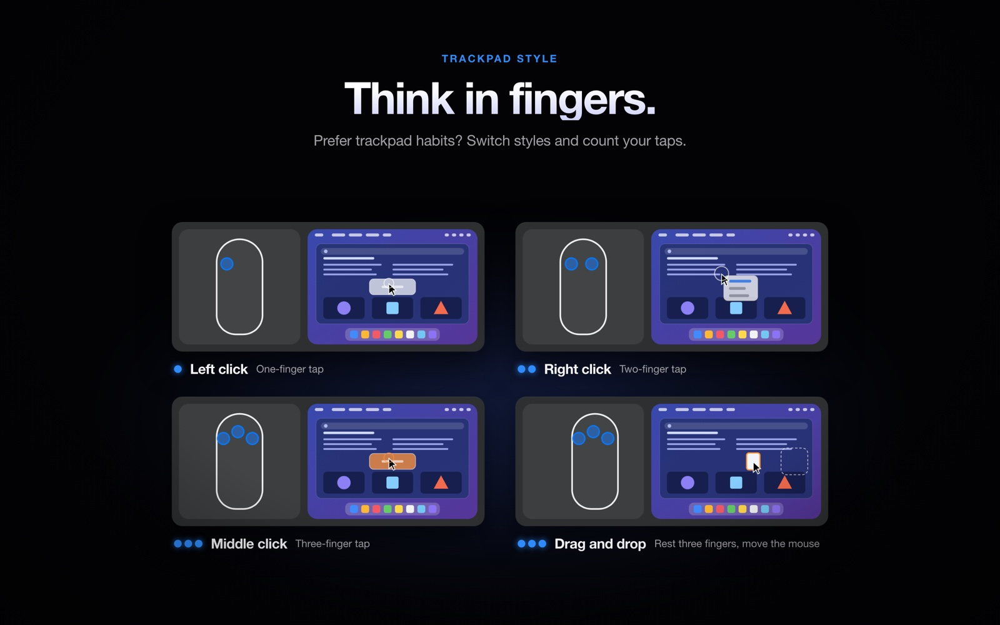
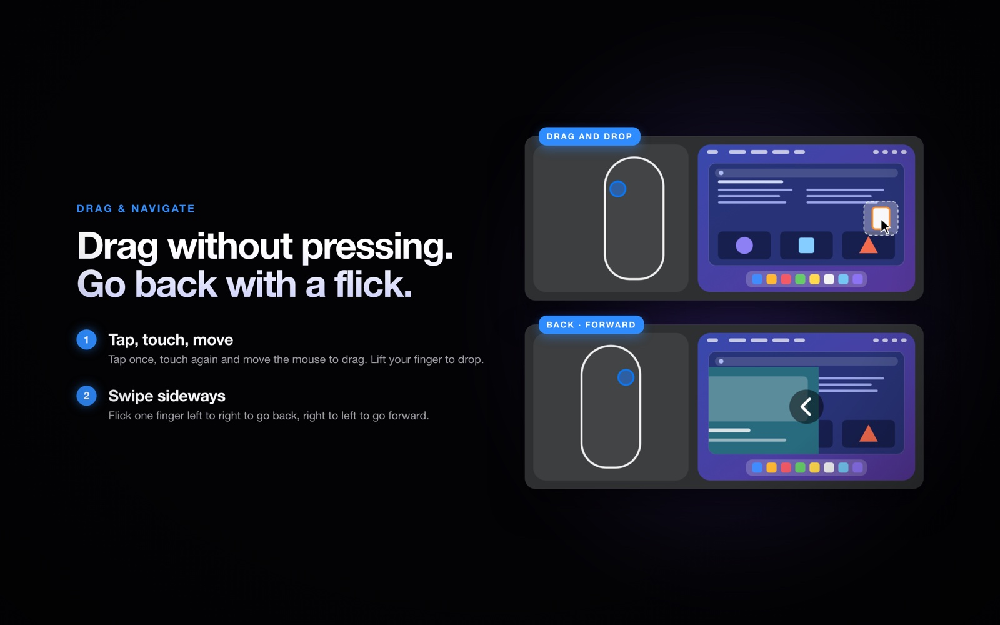
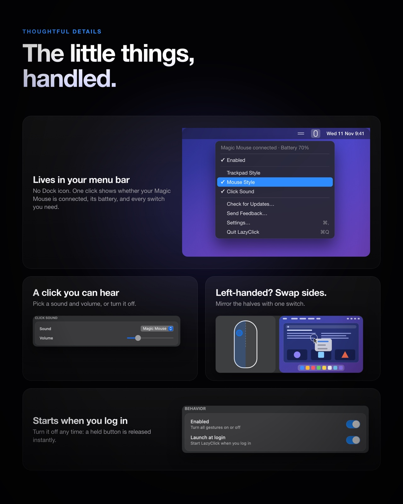

<div align="center">

# 🖱️ LazyClick

**Tap to click on your Magic Mouse.**<br>
A tiny, native menu bar app that adds touch gestures to Apple's Magic Mouse — without touching how it normally works.




<sub>The Settings window shows a looping preview of every gesture: your fingers on a top-down Magic Mouse, and what happens on a tiny desktop.</sub>

</div>

---

## ✨ Features

- 👆 **Tap to click** — tap the left or right half of the mouse for left / right click
- 🖐️ **Tap-and-drag** — tap, touch again, and move the mouse to drag; lift to drop
- 🎛️ **Two styles** — *Mouse style* (default) or *Trackpad style* (1 / 2 / 3-finger taps)
- 🔋 **Battery in the menu** — see your mouse's charge at a glance
- 🪶 **Featherweight** — Swift + AppKit, ~0 % CPU when idle; the only network use is the update check (Sparkle)
- 🔒 **Non-invasive** — physical clicks, pointer movement, scrolling and swipes are never intercepted; LazyClick only *adds* events



## 🎯 Gestures

<table>
<tr>
<td width="50%"></td>
<td width="50%"></td>
</tr>
</table>

| | 🖱️ Mouse style *(default)* | ⌨️ Trackpad style |
|---|---|---|
| **Left click** | Tap the **left half** | 1-finger tap |
| **Right click** | Tap the **right half** | 2-finger tap |
| **Middle click** | — | 3-finger tap |
| **Double-click** | 2 quick taps on the left half | 2 quick 1-finger taps |
| **Drag** | Tap once, touch again and **move the mouse** while holding | 3 fingers down + move the mouse |
| **Back / Forward** | Flick one finger **left→right** / **right→left** (⌘[ / ⌘]) | Same |



> 💡 **Tips**
> - Tap lightly and lift quickly (under ~0.3 s) without sliding — a sliding finger is a scroll.
> - In Mouse style the second touch of a drag must follow the tap within 0.4 s, near the same spot.
> - Left-handed? Turn on **Swap left and right**.

## 🚀 Getting started

### Requirements

- macOS 13 or newer, Apple Silicon
- A Magic Mouse

### Install

**Homebrew**

```sh
brew install --cask pisitpong22/tap/lazyclick
```

**Or download:** get `LazyClick.zip` from [Releases](https://github.com/pisitpong22/LazyClick/releases/latest), unzip, and drag `LazyClick.app` to Applications.

### Build from source

```sh
./build.sh                                   # tests + Release build -> build/LazyClick.app
pkill -x LazyClick                           # quit the old copy; replacing a running app makes open fail
rm -rf /Applications/LazyClick.app
cp -R build/LazyClick.app /Applications/
open /Applications/LazyClick.app
```

<details>
<summary>Build options & notes</summary>

```sh
SKIP_TESTS=1 ./build.sh                                          # skip tests
CODESIGN_IDENTITY="Apple Development: Name (TEAMID)" ./build.sh  # stable signing identity
CODESIGN_IDENTITY="Developer ID Application" ./build.sh          # release: notarize, staple -> build/LazyClick.zip
```

- Ad-hoc signed builds get a new identity on every rebuild, so macOS may ask you to re-grant Accessibility. Sign with a fixed identity to avoid that.
- *Launch at Login* works best from `/Applications`.

</details>

### Grant Accessibility access

LazyClick needs **Accessibility** to post click/drag events. On first launch a welcome window introduces the app and asks for it — click **Allow Access**, or later use the banner in Settings:

1. System Settings → Privacy & Security → **Accessibility**
2. Switch on **LazyClick**

Gestures start automatically once access is granted. Reading touches needs no permission.

## 🧭 Using it

Click the menu bar icon for **Magic Mouse status + battery**, **Enabled**, the **gesture style**, **Click Sound**, **Check for Updates**, **Send Feedback**, **Support LazyClick**, **Settings** and **Quit**. *Launch at Login* is in Settings → General. Turning *Enabled* off instantly releases any synthetic button and stops all injection. When an update is available the icon turns blue and the menu shows it at the top.

<div align="center">

</div>

## 🔧 Troubleshooting

| Problem | Fix |
|---|---|
| Nothing happens | Is Accessibility granted? Is the mouse connected (toggle its Bluetooth)? A dimmed menu bar icon means disabled / no permission / touch API fault. |
| Accessibility is on but gestures stopped after a rebuild | Switch it off and on again, or remove LazyClick (−) and re-add it. |
| Accidental clicks | Keep fingers from sliding; tap with the fingertip. |
| Swipe goes back two pages | macOS is navigating too: turn off **Swipe between pages** in System Settings → Mouse → More Gestures, or **Swipe sideways** in LazyClick. |
| Launch at Login fails | Move the app to `/Applications` and approve it in System Settings → General → Login Items. |
| Check raw touch data | `/Applications/LazyClick.app/Contents/MacOS/LazyClick --probe 15` |

## 🧩 How it works

```
MultitouchSupport (private) ──raw frames──▶ RawFrameParser ──▶ GestureEngine (pure state machine)
                                                                       │ actions
                                       CGEvent (HID tap) ◀── SyntheticMouse ◀── GestureController
```

- `Sources/LazyClickCore` — gesture engine, frame parser, controller, CGEvent poster. No private API, fully unit tested (`swift test`).
- `Sources/LazyClick` — the menu bar app. `MultitouchAdapter.swift` is the **only** file that touches the private framework.
- A gesture *session* starts when the first finger lands and ends when the last lifts; taps are decided only at the end, so staggered fingers can't produce stray clicks.
- There is **no event tap**: nothing is ever swallowed or delayed. Everything that can interrupt a drag (disable, device loss, sleep, quit, signals) releases the button.

Full design notes live in [`docs/SPEC.md`](docs/SPEC.md).

## ⚠️ Limitations

- Built on Apple's private, undocumented `MultitouchSupport.framework`, loaded at runtime. Any missing symbol → the app stays inert. Apple may change it in any macOS release, and it is not App Store compatible.
- macOS's own one-finger double-tap **Smart Zoom** may fire alongside a synthetic double-click — disable it in System Settings → Mouse if that bothers you.
- If the process is `SIGKILL`ed mid-drag, a physical click clears the stuck button.
- Two Magic Mice at once have their touches merged.
- Automated tests are green, but gesture feel on real hardware is still being tuned.

## 🗑️ Uninstall

1. Turn off *Launch at Login*, then quit from the menu.
2. Delete `/Applications/LazyClick.app`.
3. Remove it from Privacy & Security → Accessibility.
4. Optional: `defaults delete io.github.pisitpong22.LazyClick`

## 🙏 Prior art

The approach (runtime-loaded MultitouchSupport, per-frame contact decoding) was studied from [slopcore/mousetoucher](https://github.com/slopcore/mousetoucher) (MIT) and [Raphe-dev/magic-mouse-touch](https://github.com/Raphe-dev/magic-mouse-touch). No code was copied; the engine, parser, controller and tests are original.

## ☕ Support

LazyClick is free and open source. If it saves you a few clicks, you can [buy me a coffee](https://buymeacoffee.com/pisitpong).

## 📄 License

[MIT](LICENSE)

The Magic Mouse click sound (`Resources/Magic Mouse.wav`) is a short excerpt of [MAGIC MOUSE.wav](https://freesound.org/people/kintana24/sounds/371223/) by kintana24, released under [CC0](https://creativecommons.org/publicdomain/zero/1.0/).
